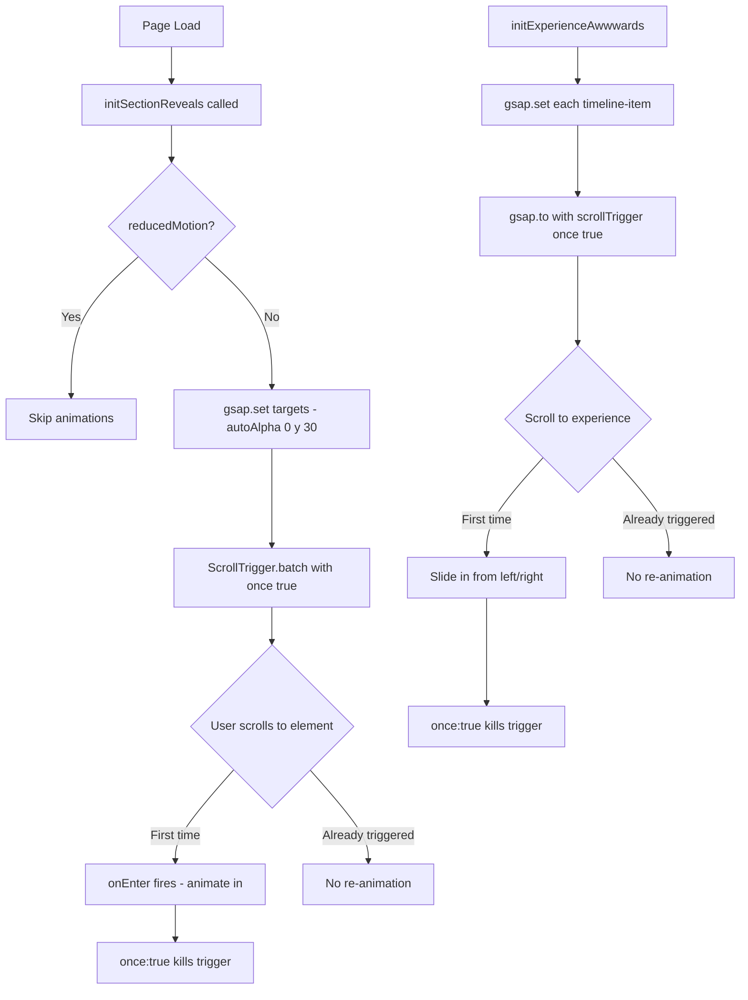

# Portfolio Website — Bug Fixes & Restyling Plan

## 🏃 How to Run Locally

Since this is a **static HTML/CSS/JS project** (no build tools), you have 3 options:

```bash
# Option 1: Python (sudah terinstall di Windows)
python -m http.server 8000

# Option 2: Node.js
npx serve .

# Option 3: VS Code Extension
# Install "Live Server" extension → Right-click index.html → "Open with Live Server"
```

Then buka `http://localhost:8000` di browser.

> **Penting:** Harus menggunakan local server (bukan buka file langsung via `file://`) karena JavaScript melakukan `fetch()` ke `skills.json` dan `projects/projects.json`.

---

## 📋 Issues Identified & Fixes

### 1. Font Change: Poppins → Plus Jakarta Sans

**Files affected:**

- [`assets/css/style.css`](../assets/css/style.css:1) — Line 1: `@import url("...Poppins...")`
- [`assets/css/style.css`](../assets/css/style.css:48) — Line 48: `font-family: "Poppins", ...`
- [`projects/style.css`](../projects/style.css) — Jika ada font reference

**Changes:**

```css
/* Replace @import */
@import url("https://fonts.googleapis.com/css2?family=Plus+Jakarta+Sans:wght@300;400;500;600;700;800&display=swap");

/* Replace font-family */
font-family:
  "Plus Jakarta Sans",
  system-ui,
  -apple-system,
  Segoe UI,
  Roboto,
  Arial,
  sans-serif;
```

---

### 2. Mobile Responsive: Experience Section Overflow

**Root Cause Analysis:**

The experience timeline uses `width: 45%` with pseudo-elements positioned at `right: -38px` / `left: -38px` on desktop. On mobile (`@media max-width: 980px`), there are overrides but several issues remain:

1. **`.timeline` grid** has no explicit `max-width: 100%` constraint
2. **`.exp-wrap`** padding + gap + logo size may push content beyond viewport
3. **`.exp-content`** text doesn't have proper `overflow-wrap` enforcement on all breakpoints
4. **Timeline pseudo-elements** (`::before`, `::after` for dots) are `display: none` on mobile — this is fine, but the **`.timeline::before`** (vertical line) has conflicting rules: line 1668-1671 sets `display: none` but line 1674-1678 tries to reposition it

**Fixes in [`assets/css/style.css`](../assets/css/style.css):**

```css
/* In @media (max-width: 980px) block: */

/* Fix timeline container */
.timeline {
  padding: 0 !important;
  margin: 0 !important;
  width: 100% !important;
  max-width: 100% !important;
  overflow: hidden !important;
  box-sizing: border-box !important;
}

/* Fix timeline items - ensure they stay within viewport */
.timeline-item {
  width: 100% !important; /* Changed from 'auto' to '100%' */
  margin: 0 0 16px 0 !important;
  padding: 0 !important;
  box-sizing: border-box !important;
  max-width: 100% !important;
  overflow: hidden !important;
}

/* Fix exp-wrap card container */
.timeline-item .exp-wrap {
  width: 100% !important;
  max-width: 100% !important;
  padding: 14px !important;
  box-sizing: border-box !important;
  overflow: hidden !important;
}

/* Fix exp-content text overflow */
.timeline-item .exp-content {
  flex: 1 !important;
  min-width: 0 !important;
  overflow: hidden !important;
}

.timeline-item h3 {
  font-size: 14px !important;
  overflow-wrap: break-word !important;
  word-break: break-word !important;
}
```

Also add a smaller breakpoint for very small screens:

```css
@media (max-width: 480px) {
  .exp-logo {
    width: 40px !important;
    height: 40px !important;
    padding: 4px !important;
  }

  .exp-wrap {
    gap: 10px !important;
    padding: 10px !important;
  }

  .timeline-item h3 {
    font-size: 13px !important;
  }
}
```

---

### 3. Fade-In Animation: Only Trigger Once

**Root Cause Analysis:**

The code already has `once: true` and `toggleActions: "play none none none"` in the animation functions:

- [`initSectionReveals()`](../assets/js/script.js:413) — Line 428-444: Uses `ScrollTrigger.batch()` with `once: true` ✅
- [`initExperienceAwwwards()`](../assets/js/script.js:447) — Line 467-484: Uses `toggleActions: "play none none none"` + `once: true` ✅
- [`loadSkills()`](../assets/js/script.js:507) — Line 543-547: Uses `once: true` ✅
- [`loadProjectsPreview()`](../assets/js/script.js:554) — Line 586-593: Uses `once: true` ✅

**However**, the custom smooth scroller in [`initSmoothScroller()`](../assets/js/script.js:110) creates a `ScrollTrigger.scrollerProxy()` that continuously updates `content.style.transform` on every frame. This can cause ScrollTrigger to recalculate positions and potentially re-trigger animations because:

1. The smooth scroller interpolates scroll position (`current += (target - current) * ease`)
2. `ScrollTrigger.update()` is called every frame (line 161)
3. This can cause `start` positions to be re-evaluated, potentially re-triggering `onEnter`

**Fix:** Add a guard to prevent re-triggering by tracking animated elements:

```javascript
// In initSectionReveals(), initExperienceAwwwards(), etc.
// Add at the top of each animation function:
const animatedElements = new Set();

// Then in ScrollTrigger.batch onEnter callback:
onEnter: (batch) => {
  const newBatch = batch.filter((el) => !animatedElements.has(el));
  if (!newBatch.length) return;
  newBatch.forEach((el) => animatedElements.add(el));
  // ... animate newBatch
};
```

**OR** more elegantly, use `ScrollTrigger.batch`'s built-in `once: true` which should work, but also add `invalidateOnRefresh: false` to prevent position recalculation:

```javascript
ScrollTrigger.batch(targets, {
  start: isMobile ? "top 95%" : "top 85%",
  onEnter: (batch) => {
    /* ... */
  },
  once: true,
  // Prevent ScrollTrigger from re-evaluating after refresh
});
```

The most reliable fix is to **kill ScrollTrigger instances after animation completes**:

```javascript
onEnter: (batch) => {
  gsap.fromTo(batch,
    { y: 30, autoAlpha: 0 },
    {
      y: 0, autoAlpha: 1,
      duration: 0.8,
      ease: "power3.out",
      stagger: 0.1,
      overwrite: true,
      onComplete: () => {
        // Remove from future triggers
        batch.forEach(el => ScrollTrigger.getAll()
          .filter(st => st.trigger === el)
          .forEach(st => st.kill())
        );
      }
    }
  );
},
once: true
```

---

### 4. Other UI Glitches Found

#### 4a. 404 Page Not Customized

[`404.html`](../404.html) still references "Jigar" (original template author) instead of "Kelvin Erlangga". Contact info shows Indian phone number and Pune address.

#### 4b. Leftover Files

- [`assets/js/app.js`](../assets/js/app.js) — particles.js config, not referenced in main [`index.html`](../index.html)
- [`assets/js/particles.min.js`](../assets/js/particles.min.js) — particles.js library, not used

#### 4c. Light Mode Header Background

On mobile, the header has:

```css
.site-header {
  background: rgba(7, 10, 18, 0.98) !important;
}
```

This forces dark background even in light mode on mobile.

#### 4d. Visitor Slider Unused

The visitor slider CSS (lines 1960-2135) exists but no corresponding HTML/JS uses it. It's dead CSS.

---

## 🔧 Implementation Order

| Step | Task                                    | Files                                            |
| ---- | --------------------------------------- | ------------------------------------------------ |
| 1    | Change font to Plus Jakarta Sans        | `assets/css/style.css`, `projects/style.css`     |
| 2    | Fix experience section mobile overflow  | `assets/css/style.css`                           |
| 3    | Fix fade-in animation one-shot behavior | `assets/js/script.js`                            |
| 4    | Fix light mode header on mobile         | `assets/css/style.css`                           |
| 5    | Clean up 404 page                       | `404.html`, `assets/css/404.css`                 |
| 6    | Remove dead CSS (visitor slider)        | `assets/css/style.css`                           |
| 7    | Consider removing unused files          | `assets/js/app.js`, `assets/js/particles.min.js` |

---

## 📊 Mermaid Flow — Animation Fix Logic


